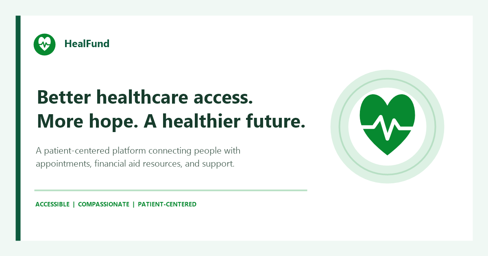

# HealFund — A Healthier Future, Made Easier

HealFund is a patient-centered digital platform built to make healthcare access simpler, more organized, and more accessible. It brings patients, families, and healthcare teams together through a trusted online experience that supports the healthcare journey, from initial verification to hospital follow-up.

The platform provides convenient access to appointment booking, financial aid information, patient support, and healthcare guidance. With a user-friendly interface, clear navigation, and multilingual accessibility, HealFund aims to reduce the difficulty of finding and managing essential healthcare services.

## Live websites

- Patient portal: [Open the HealFund patient website](https://healfund.onrender.com/)

## Key website features

- **Appointment Booking:** Helps patients arrange and manage healthcare appointments.
- **Financial Aid:** Provides access to information and support related to healthcare financial assistance.
- **Patient Verification:** Supports the verification process to help patients access relevant services.
- **Help and Support:** Gives users a place to seek assistance and guidance.
- **Patient Follow-up:** Supports continuity throughout the healthcare journey.
- **Multilingual Interface:** Offers language selection to make the platform more accessible.
- **Contact and Information:** Makes it easier for patients to find information about the organization and reach its support team.

## Short description

HealFund is an online healthcare access platform that connects patients with appointment services, financial aid resources, verification, and support. It aims to simplify the healthcare journey and help individuals and families find the assistance they need.

## tagline

> HealFund — Better Healthcare Access. More Hope. A Healthier Future.

## Project presentation description

HealFund is a digital healthcare platform developed to improve access to healthcare services and financial assistance. By bringing appointment booking, patient verification, financial aid information, and support services together in one place, the platform aims to create a more convenient and patient-focused experience. Its mission is to help patients and families navigate healthcare with greater confidence, accessibility, and support.

## Project presentation

- [Watch the HealFund presentation video](https://drive.google.com/file/d/1zDVQOjptqn0G3GupWRGmOogacnnmlEeA/view?usp=sharing)
- [Open the HealFund presentation slides](https://docs.google.com/presentation/d/1XuT1JWx6Axrr18rKMRbS9tM78PVLFNdB/edit?usp=sharing&ouid=100479346373940797298&rtpof=true&sd=true)

## Brand preview



Use the live link above to explore the patient portal.

## Docker

Copy `.env.docker.example` to `.env` and set `JWT_SECRET`, `CHAPA_SECRET_KEY`, and the Gmail email settings. Keep the default `MONGO_URI` when using the bundled Docker database; set `BACKEND_PUBLIC_URL` when exposing the backend publicly for provider callbacks.
Then start the backend and both frontends from the repository root:

```bash
docker compose up --build
```

Open the applications at:

- Patient portal: http://localhost:3000

Uploaded files are stored in the persistent `healfund_uploads` Docker volume.

## Patient notifications

The patient portal stores appointment, document-verification, queue, and confirmed-donation updates in the patient's notification inbox. Patients can enable browser push from their dashboard; supported browsers can display those notifications while the site is closed, provided the browser/device can reach the internet. Push cannot be delivered while a device is offline. Email is used as a fallback when a push subscription is unavailable or delivery fails, and requires the backend email settings above.

Admins and hospital staff can also create patient accounts from the Users tab. They set an initial password and should share it privately with the patient, who can change it after signing in. Hospital staff can edit or delete only the patient accounts they created; administrators retain patient-management access.

## Development checks

Development validation has included checking the backend health endpoint, authentication and protected access, patient and admin account workflows, and frontend builds. These checks do not replace ongoing production monitoring or testing with the services configured for a deployment.

## Team

| Name | Roles | CTC ID |
|---|---|---|
| Beza Abera Tibebu | Patient frontend, backend, admin backend, payment system and deployment |CTC-4297-26 |
| Bezawit Kibret Kebede | Admin frontend | CTC-2238-26 |
